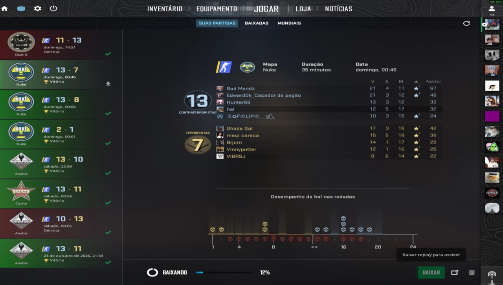

## 1. Baixe as demos no CS2

No jogo: **JOGAR → SUAS PARTIDAS** e clique em **BAIXAR** em cada partida que
quiser enviar. Espere a barra chegar em 100%.



## 2. Windows: cole esta linha no PowerShell

```powershell
irm https://cs2.allanpinheiro.com/cs2stats.ps1 -OutFile "$env:TEMP\cs2stats.ps1"; powershell -ExecutionPolicy Bypass -File "$env:TEMP\cs2stats.ps1"
```

Ele acha as demos baixadas sozinho, lê cada uma no seu PC e envia só as
estatísticas. A demo não sai da sua máquina.

## 3. Mac: cole esta linha no Terminal

```bash
curl -fsSL https://cs2.allanpinheiro.com/cs2stats.sh -o "$TMPDIR/cs2stats.sh"; bash "$TMPDIR/cs2stats.sh"
```

Ele acha as demos baixadas sozinho, lê cada uma no seu Mac e envia só as
estatísticas. A demo não sai da sua máquina.
