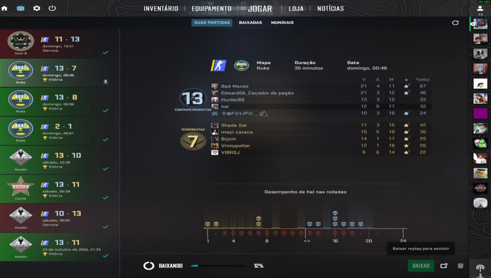

## 1. Baixe as demos no CS2

No jogo: **JOGAR → SUAS PARTIDAS** e clique em **BAIXAR** em cada partida que
quiser enviar. Espere a barra chegar em 100%.



## 2. Cole esta linha no PowerShell (Windows)

```powershell
irm https://cs2.allanpinheiro.com/cs2stats.ps1 -OutFile "$env:TEMP\cs2stats.ps1"; powershell -ExecutionPolicy Bypass -File "$env:TEMP\cs2stats.ps1"
```

Ele acha as demos baixadas sozinho, lê cada uma no seu PC e envia só as
estatísticas. A demo não sai da sua máquina.
